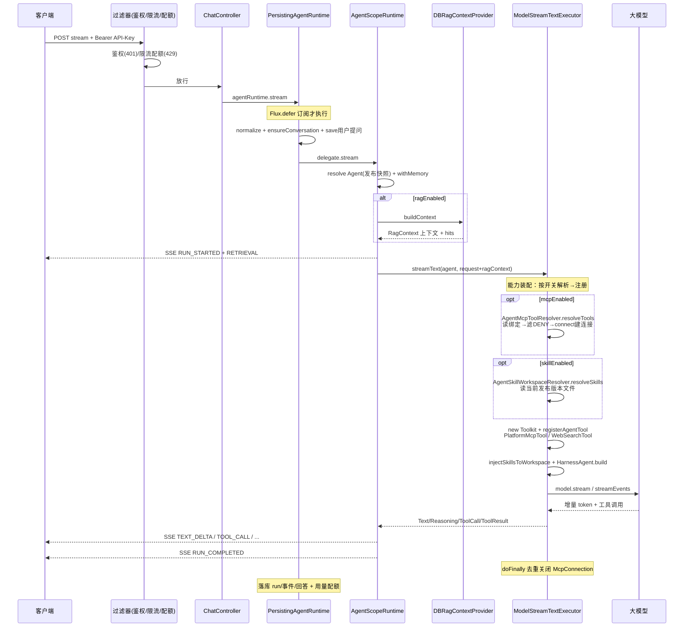
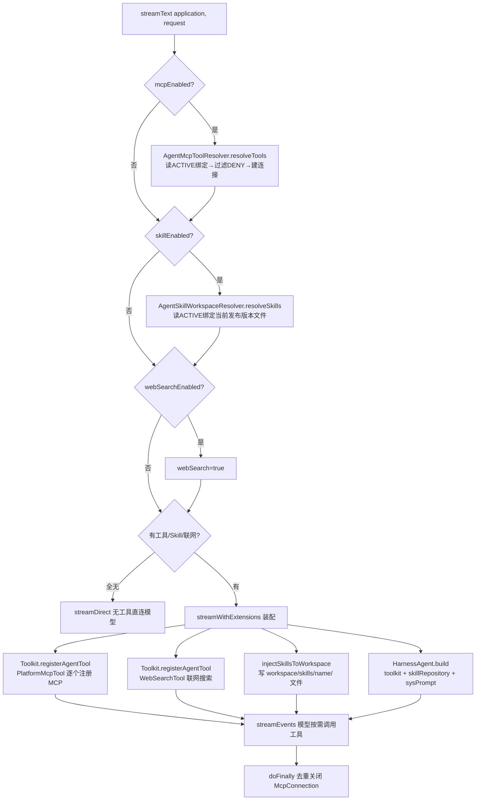
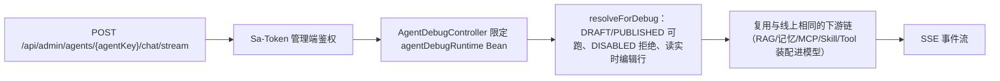

# v5ai-nb

基于 JDK 21、Spring Boot 4.1.0、AgentScope Java、MyBatis-Plus、PostgreSQL + pgvector 和 Sa-Token + JWT 构建的中心化 AI 应用平台（Dify 风格，不使用 Server-Agent/gRPC 架构）。

当前已完成 **Phase 1（模型与 Agent 闭环）**、**Phase 2（RAG 知识库）**、**Phase 3（MCP）**、**Phase 4（Skill）** 与 **Phase 5（平台增强）**：

- 认证（Sa-Token + JWT）、Provider/Model 管理与凭据 AES-GCM 加密、模型连通性测试；
- **Agent**（原 Application 概念，V8 迁移重命名）：草稿/更新/禁用/发布版本、**系统提示词（systemPrompt）配置并随发布版本固化**、API Key 管理（BCrypt 存储）；
- AgentScope 运行时边界：流式/阻塞对话、SSE 平台事件（RUN_STARTED/MODEL_CALL/TEXT_DELTA/TOOL_CALL/TOOL_RESULT/PERMISSION_REQUIRED/MESSAGE_COMPLETED/RUN_FAILED/RUN_COMPLETED/RETRIEVAL 等）、会话/消息/run/run_event/AgentState 持久化、会话历史与恢复；
- RAG：知识库、文档上传（TXT/MD/PDF/DOCX）与 URL 导入、异步 Worker（解析 → 切片 → Embedding → pgvector 写入）、向量/关键词检索、运行时引用上下文注入与 RETRIEVAL 事件；
- MCP：Server 注册（Streamable HTTP / SSE / Stdio，headers/env 加密存储）、连接测试、Tool 发现与缓存、Agent 绑定、运行时动态 Tool 注册（AgentScope Toolkit）、Tool 权限三态（ALLOW/APPROVE/DENY）与调用审计（runId/工具名/参数摘要/状态/耗时）、Stdio 命令白名单；
- Skill：zip 包上传与结构校验（SKILL.md frontmatter、路径穿越/大小/编码）、版本发布与回滚（当前版本指针）、Agent 绑定、运行时 Workspace 注入（`skills/<name>/` + 只读 Skill 仓库注入 `<available_skills>`）、禁用；
- 平台增强：RBAC（角色 admin/user + 管理 API 登录拦截与写操作 admin 校验）、按应用配额与每分钟限流（超限 429）、模型调用用量记录与统计、管理操作审计日志、`/api/health` 与总览统计（可观测性）、启动自动种子默认管理员；
- 管理前端：登录、Provider/Model（凭据表单化 + 连通性测试）、Agent（模型下拉 + 知识库/MCP/Skill 绑定 + 生成 Key）、知识库管理、MCP Server 管理、Skill 管理、Platform（用户/角色/菜单）、Observability（统计/用量/审计）、Chat Debug。

## 技术基线

- JDK 21
- Spring Boot 4.1.0 / WebFlux
- MyBatis-Plus（显式装配 `SqlSessionFactory`，兼容 Spring Boot 4）
- Flyway
- Sa-Token + JWT
- BCrypt / AES-GCM
- PostgreSQL + pgvector（`vector(1536)` 余弦检索）
- AgentScope Java 2.0（`agentscope-harness`、`agentscope-extensions-model-openai/dashscope`）
- PDFBox 3.0.7（PDF 解析）

## 模块

- `v5ai-common`: 公共响应、异常、分页、API Key 校验端口和平台领域（租户/用户/角色/配额/用量/审计/限流）
- `v5ai-model`: 模型配置与凭证加密、连通性测试端口
- `v5ai-agent`: Agent 草稿/更新/禁用/发布/版本解析核心
- `v5ai-runtime`: Agent 运行时边界、事件模型、会话/消息/run/AgentState 持久化装饰器、用量埋点、RAG 上下文端口
- `v5ai-rag`: 知识库/文档/任务领域模型、解析/切片/Embedding/向量存储端口、检索上下文构建
- `v5ai-mcp`: MCP Server/工具/审计领域模型、管理服务（连接测试、Tool 发现、Agent 绑定、权限）、连接与 Stdio 策略端口
- `v5ai-skill`: Skill 包解析校验、版本发布/回滚、Agent 绑定、运行时 Workspace 注入端口
- `v5ai-worker`: 文档索引 Worker（异步任务状态机 + `@Scheduled` 调度 + 重试）
- `v5ai-infrastructure`: MyBatis-Plus、Sa-Token、BCrypt、AES-GCM、pgvector、MinIO/Redisson、AgentScope MCP/Skill 运行时实现、租户/用户/配额/用量/审计/限流实现、各端口实现
- `v5ai-api`: 管理 API（含租户/用户/配额/用量/审计/统计/健康）、运行 API（SSE + 限流/配额）、API Key 过滤器、Sa-Token 管理拦截（RBAC）
- `v5ai-starter`: Spring Boot 启动模块（`scanBasePackages="xin.v5ai.nb"` + `@MapperScan` + `@EnableScheduling`）
- `v5ai-ui`: Vue 3 + Vite + TypeScript + Naive UI 管理前端

## 运行时调用链路（RAG / MCP / Skill / Tool 装配）

> 一次运行从 HTTP 进来到 SSE 逐条推回，所有中间步骤都是同一条 Reactor `Flux` 链上的惰性执行（`Flux.defer` 在订阅时才真正开始）。RAG 检索、MCP/Skill/Tool 装配都发生在「模型首 token 之前」。

### 1. 在线流式调用全链路（`POST /api/v1/agents/{agentKey}/chat/stream`）



### 2. 能力装配内部（`ModelStreamTextExecutor`）



### 3. 调试链路（`POST /api/admin/agents/{agentKey}/chat/stream`，`resolveForDebug`）

管理端调试接口与线上共享**同一条下游链**（同一个 `PersistingAgentRuntime` → `AgentScopeRuntime` → RAG/记忆/MCP/Skill/Tool 装配 → 模型），仅「鉴权方式」与「Agent 解析源」不同：

| 维度 | 线上 `/api/v1` | 调试 `/api/admin` |
|---|---|---|
| 端点 | `POST /api/v1/agents/{key}/chat/stream` | `POST /api/admin/agents/{key}/chat/stream` |
| 鉴权 | Agent API Key（`Bearer`，BCrypt 比对）+ 限流/配额 | 管理端 Sa-Token 登录（`/api/admin/**` 拦截），无需 API Key |
| 运行时 Bean | `agentRuntime` | `agentDebugRuntime`（`@Qualifier`，两个同类型 Bean 需显式限定） |
| Agent 解析 | `PublishedAgentResolver.resolve`：仅 `PUBLISHED`，读**发布版本快照** | `PublishedAgentResolver.resolveForDebug`：`DRAFT`/`PUBLISHED` 可跑，`DISABLED` 拒绝，读**实时编辑行** |
| 下游装配 | 相同 | 相同 |



关键差异：线上 `resolve()` 按 `publishedVersion` 找 `v5ai_agent_version.snapshot_json` 还原标量字段（模型/系统提示词/5 个能力开关/展示字段），编辑未重新发布不影响线上；调试 `resolveForDebug()` 直接返回实时编辑行，便于在草稿态下预览/调试。MCP/Skill/RAG 绑定列表两路都不固化、仍按 `agentKey` 实时解析。

### 4. SSE 事件顺序

```
RUN_STARTED → RETRIEVAL(有 RAG 命中) → MODEL_CALL
  → (TEXT_DELTA | REASONING_DELTA)* | (TOOL_CALL → TOOL_RESULT)*
  → MESSAGE_COMPLETED → RUN_COMPLETED
失败路径：RUN_FAILED；需授权：PERMISSION_REQUIRED
```

### 5. 关键实现位置

| 环节 | 类 |
|---|---|
| 鉴权/限流/配额 | `AgentApiKeyServletFilter`（线上）；`/api/admin/**` 由 Sa-Token 拦截（调试） |
| 调试控制器 | `AgentDebugController`（`@Qualifier("agentDebugRuntime")`） |
| Agent 解析 | `PublishedAgentResolver.resolve` / `resolveForDebug` |
| 持久化装饰器 | `PersistingAgentRuntime`（先 save 用户提问，再 delegate；`doOnNext` 边推边落库） |
| 编排 + RAG/记忆门控 | `AgentScopeRuntime`（`ragEnabled` / `memoryEnabled`） |
| RAG 检索 | `DBRagContextProvider` → `RetrievalContextBuilder`（向量 topK=4，空回退关键词，融合可选） |
| 工具装配 | `ModelStreamTextExecutor.streamText` / `streamWithExtensions` |
| MCP 解析 | `AgentMcpToolResolver`（读 ACTIVE 绑定、滤 DENY、建连接） |
| Skill 解析 | `AgentSkillWorkspaceResolver`（读当前发布版本文件） |
| 联网搜索 | `WebSearchTool`（Tavily，`v5ai.agentscope.tavily-api-key`，缺 Key 返回错误） |

## 本地验证

```bash
mvn -Dmaven.repo.local=/private/tmp/v5ai-m2 clean verify -Dsurefire.failIfNoSpecifiedTests=false
cd v5ai-ui
npm install
npm run build
```

启动前需要 PostgreSQL（含 pgvector 扩展）与配置：

```bash
V5AI_DATASOURCE_URL=jdbc:postgresql://localhost:5432/v5ai_nb
V5AI_DATASOURCE_USERNAME=v5ai
V5AI_DATASOURCE_PASSWORD=change-me
V5AI_JWT_SECRET=change-this-development-secret
V5AI_CREDENTIAL_CIPHER_KEY=replace-with-32-byte-secret-value
```

启动后：

1. `POST /api/auth/login`（无用户时启动自动创建默认管理员 `admin/admin`，生产务必改密）获取管理员 Token；
2. 配置 Provider 与 Model（`POST /api/admin/providers`、`POST /api/admin/models`，可在 UI 上连通性测试）；
3. 创建并发布 Agent，`POST /api/admin/agents/{agentKey}/api-keys` 生成运行 API Key；
4. 创建知识库、上传文档（`POST /api/admin/knowledge-bases/{kbId}/documents`，multipart），Worker 异步索引；
5. 将知识库绑定到 Agent（`POST /api/admin/agents/{agentKey}/knowledge-bindings`）；
6. 创建 MCP Server（`POST /api/admin/mcp-servers`）→ 测试连接 → 发现工具（`POST /api/admin/mcp-servers/{id}/discover-tools`）→ 绑定到 Agent（`POST /api/admin/agents/{agentKey}/mcp-bindings`）；
7. 上传 Skill 包（`POST /api/admin/skills`，multipart zip）→ 发布版本（`POST /api/admin/skills/{id}/versions/{versionId}/publish`）→ 绑定到 Agent（`POST /api/admin/agents/{agentKey}/skill-bindings`）；
8. 通过 `POST /api/v1/agents/{agentKey}/chat/stream`（Agent API Key）发起流式对话：带 RAG 上下文，MCP 工具被动态注册（调用记录可查 `GET /api/admin/mcp-tool-calls?runId=<run-id>`），绑定 Skill 自动注入 Workspace；
9. 可在 Platform 页配置应用配额/限流（`PUT /api/admin/agents/{agentKey}/quota`），在 Observability 页查看用量明细、审计日志与总览（`GET /api/admin/usage`、`GET /api/admin/audit-logs`、`GET /api/admin/stats/overview`）。

说明：

- 未配置 EMBEDDING 模型时，向量化回退到确定性本地 Hash 嵌入（维度 1536），便于本地端到端验证；
- 数据库迁移：`v5ai-infrastructure/src/main/resources/db/migration/`（V1 Phase 1、V2 RAG、V5 MCP、V6 Skill、V7 平台增强，需 pgvector）；
- MCP 运行时使用已发现的 Tool 元数据：先"发现工具"再"绑定 + 发布"，运行时才会注册工具；
- Skill 上传生成 DRAFT 版本，发布后成为"当前版本"，运行时注入当前版本文件（回滚改变当前版本）；
- Stdio MCP 命令受白名单限制（`V5AI_MCP_STDIO_COMMAND_WHITELIST`，生产环境必须配置）；
- 管理 API 现在强制登录（写操作需 admin 角色）；运行时 API 按应用配额/限流（超限 429）；
- 限流器为进程内实现（单实例），多实例部署需替换 Redis；Token 用量按字符数估算；
- Workflow 仍属后续阶段。

更多说明见：

- `docs/deploy/dev.md`（开发环境部署文档）
- `docs/api/phase1.md`
- `docs/api/phase2.md`
- `docs/api/phase3.md`
- `docs/api/phase4.md`
- `docs/api/phase5.md`
- `docs/phase1-verification-update.md`
- `docs/phase2-verification.md`
- `docs/phase3-verification.md`
- `docs/phase4-verification.md`
- `docs/phase5-verification.md`
